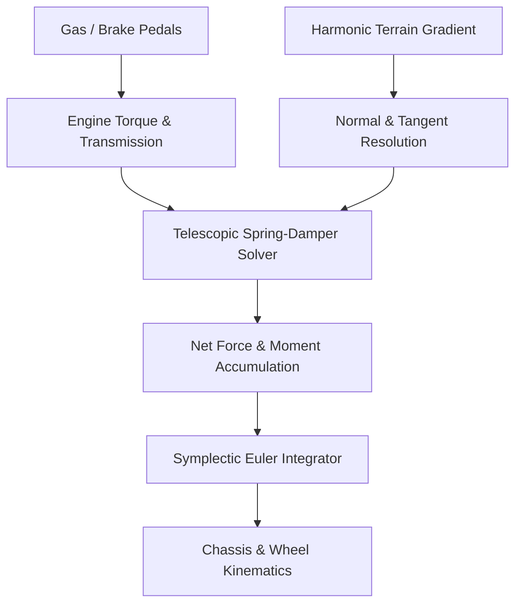

# Mathematical Physics, Graphics Programming, and Procedural Track Generation Architecture

This document provides a publication-grade, mathematically rigorous reference of the core engineering subsystems powering **Hill Climb Racing Qt**:
1. **Graphics Programming & Software Rasterization Pipeline**
2. **Mathematical Physics Engine & Rigid Body Dynamics**
3. **Procedural Track & Biome Synthesis**

---

## 1. Graphics Programming & Pure Software Rasterization Pipeline

The graphics subsystem operates without hardware acceleration or OpenGL shaders. Every pixel is rendered directly to a CPU-managed linear framebuffer and blitted to screen via a 60 Hz paint event.


### 1.1 Linear Framebuffer Architecture
The framebuffer allocates a contiguous memory buffer of 32-bit unsigned integers:
$$\text{Buffer Size} = W \times H \times 4 \text{ bytes}$$
Where each pixel is packed into 32-bit ARGB format:
$$P = (\alpha \ll 24) \mid (R \ll 16) \mid (G \ll 8) \mid B$$
Direct memory addressing allows direct memory copy and scanline pointer indexing:
$$\text{Pixel Address}(x, y) = \text{m\_data} + (y \times W + x)$$

### 1.2 Sub-Pixel Precision & Camera Coordinate Transformation
World coordinates $(X_w, Y_w)$ in physical meters are mapped to viewport screen coordinates $(X_s, Y_s)$ via an affine transformation:
$$X_s = \frac{W}{2} + (X_w - X_{\text{cam}}) \cdot S_x$$
$$Y_s = \frac{H}{2} - (Y_w - Y_{\text{cam}}) \cdot S_y$$
Where:
- $(X_{\text{cam}}, Y_{\text{cam}})$ is the camera position centered on the vehicle chassis.
- $S_x = S_y = 16.0\,\text{pixels/meter}$ is the optical magnification scale.
- The vertical axis is inverted ($-$) because screen coordinates have their origin $(0, 0)$ at the top-left corner, whereas the physics world Cartesian coordinate system points upward ($+Y$).

### 1.3 High-Performance Alpha Blending
Alpha blending of a source color $C_{\text{src}}$ over a destination color $C_{\text{dst}}$ with opacity $\alpha \in [0, 255]$ is computed per color channel without floating-point division using integer bit shifting:
$$C_{\text{out}} = \frac{C_{\text{src}} \cdot \alpha + C_{\text{dst}} \cdot (256 - \alpha)}{256} \approx \left( C_{\text{src}} \cdot \alpha + C_{\text{dst}} \cdot (255 - \alpha) \right) \gg 8$$
In vectorized C++ form:
```cpp
uint32_t rbSrc = src & 0x00FF00FF;
uint32_t gSrc  = src & 0x0000FF00;
uint32_t rbDst = dst & 0x00FF00FF;
uint32_t gDst  = dst & 0x0000FF00;

uint32_t rb = (((rbSrc - rbDst) * a) >> 8) + rbDst;
uint32_t g  = (((gSrc  - gDst)  * a) >> 8) + gDst;
uint32_t out = (rb & 0x00FF00FF) | (g & 0x0000FF00) | 0xFF000000;
```

### 1.4 Scanline Polygon Fill Algorithm
Terrain polygons (sub-surface soil strata, rock beds, grass crust) are rendered using a scanline edge-walking algorithm:
1. Vertices along the terrain surface are sampled at regular screen-pixel intervals $\Delta X = 1$.
2. For each horizontal coordinate $x \in [0, W - 1]$, the terrain height $y_s(x)$ is computed.
3. The vertical span from $y_s(x)$ to the bottom of the screen $H - 1$ is filled line-by-line, dynamically modulating pixel color based on depth $d = y - y_s(x)$:
   - **Layer 1 ($d \in [0, 4]$ px)**: Grass crest / sunlit turf ($0\text{xFF81C784}$).
   - **Layer 2 ($d \in [5, 24]$ px)**: Rich topsoil ($0\text{xFF5D4037}$).
   - **Layer 3 ($d > 24$ px)**: Sub-surface bedrock with procedural pseudo-random mineral noise ($0\text{xFF3E2723}$).

---

## 2. Mathematical Physics Engine & Rigid Body Dynamics

The physics backend executes at a fixed timestep $\Delta t = \frac{1}{60}\,\text{s}$ ($60\,\text{Hz}$) with deterministic numerical integration.



### 2.1 Telescopic Suspension Spring-Damper System
Each wheel (rear and front) is mounted to the rigid chassis via a spring-damper telescopic strut with rest length $L_0$, spring stiffness $k_s$, and viscous damping coefficient $c_d$.

The instantaneous strut length $L(t)$ is the distance from chassis mount $\vec{P}_{\text{mount}}$ to the ground contact surface $\vec{P}_{\text{ground}}$ along the strut axis unit vector $\hat{u}_{\text{down}}$:
$$L(t) = \frac{(\vec{P}_{\text{ground}} - \vec{P}_{\text{mount}}) \cdot \hat{n}}{\hat{u}_{\text{down}} \cdot \hat{n}}$$

The compression displacement is:
$$\Delta x = \max(0, \, L_0 - L(t))$$
The compression velocity is:
$$v_{\text{comp}} = - \frac{dL}{dt} = - (\vec{v}_{\text{mount}} - \vec{v}_{\text{ground}}) \cdot \hat{u}_{\text{down}}$$

The suspension reaction force magnitude $F_{\text{susp}}$ obeys the asymmetric damped harmonic oscillator equation:
$$F_{\text{susp}} = k_s \Delta x + c_{\text{eff}} v_{\text{comp}}$$
Where the damping coefficient $c_{\text{eff}}$ features asymmetric bump/rebound ratio to prevent catapulting:
$$c_{\text{eff}} = \begin{cases} c_d (1.0 + 0.10 |v_{\text{comp}}|) & \text{if } v_{\text{comp}} \ge 0 \quad (\text{Compression / Bump}) \\ 2.8 \, c_d & \text{if } v_{\text{comp}} < 0 \quad (\text{Rebound / Extension}) \end{cases}$$

### 2.2 Ground Normal & Tangential Friction Cone (Pacejka Model)
At contact coordinate $x$, the terrain slope is $\frac{dy}{dx} = m$. The unit surface normal $\hat{n}$ and unit surface tangent $\hat{t}$ are:
$$\hat{n} = \frac{1}{\sqrt{1 + m^2}} \begin{pmatrix} -m \\ 1 \end{pmatrix}, \qquad \hat{t} = \frac{1}{\sqrt{1 + m^2}} \begin{pmatrix} 1 \\ m \end{pmatrix}$$

The net normal force exerted on the tire is:
$$F_N = F_{\text{susp}} + m_{\text{wheel}} g (\hat{n} \cdot \hat{j})$$
By Coulomb's friction law with tire-ground friction coefficient $\mu$:
$$F_{\text{max\_friction}} = \mu F_N$$

The drive force generated by the engine torque $\tau_e$ through tire radius $R_w$ is:
$$F_{\text{drive}} = \frac{\tau_e}{R_w}$$
The net tractive force along the tangent $\hat{t}$ is clamped to the friction cone:
$$F_{\text{tractive}} = \text{clamp}\left( F_{\text{drive}} - F_{\text{brake}}, \, -F_{\text{max\_friction}}, \, F_{\text{max\_friction}} \right)$$

### 2.3 Rigid Body Equations of Motion (Symplectic Euler Integration)
Let the chassis have mass $M$, moment of inertia $I$, center of mass $\vec{P}_c$, linear velocity $\vec{V}_c$, chassis pitch angle $\theta$, and angular velocity $\omega = \dot{\theta}$.

The equations of motion are:
$$M \frac{d\vec{V}_c}{dt} = M \vec{g} + \sum_{i \in \{\text{rear}, \text{front}\}} \left( F_{N, i} \hat{n}_i + F_{\text{tractive}, i} \hat{t}_i \right) + \vec{F}_{\text{aero}}$$
$$I \frac{d\omega}{dt} = \sum_{i \in \{\text{rear}, \text{front}\}} \left( (\vec{P}_{\text{mount}, i} - \vec{P}_c) \times (F_{N, i} \hat{n}_i + F_{\text{tractive}, i} \hat{t}_i) \right) + \tau_{\text{air\_gyro}} + \tau_{\text{weight\_transfer}}$$

Integration over timestep $\Delta t$:
$$\vec{V}_c(t + \Delta t) = \vec{V}_c(t) + \frac{\vec{F}_{\text{net}}}{M} \Delta t$$
$$\omega(t + \Delta t) = \omega(t) + \frac{\tau_{\text{net}}}{I} \Delta t$$
$$\vec{P}_c(t + \Delta t) = \vec{P}_c(t) + \vec{V}_c(t + \Delta t) \Delta t$$
$$\theta(t + \Delta t) = \theta(t) + \omega(t + \Delta t) \Delta t$$

### 2.4 Dynamic Weight Transfer & Mid-Air Gyro
1. **Dynamic Weight Transfer**:
   Under forward acceleration ($u_{\text{gas}} > 0$), chassis squat torque is applied:
   $$\tau_{\text{squat}} = + 360.0 \cdot u_{\text{gas}} \quad (\text{pitches nose up})$$
   Under heavy braking ($u_{\text{brake}} > 0$):
   $$\tau_{\text{dive}} = - 420.0 \cdot u_{\text{brake}} \quad (\text{pitches nose down})$$

2. **Airborne Gyroscope Reaction**:
   When neither tire is contacting the terrain ($c_{\text{rear}} = 0, c_{\text{front}} = 0$):
   $$\tau_{\text{air\_gyro}} = 780.0 \cdot K_{\text{agility}} \cdot (u_{\text{gas}} - u_{\text{brake}})$$
   Allowing the driver to execute 360-degree backflips and frontflips in mid-air.

---

## 3. Procedural Track & Biome Synthesis

Terrain profiles are generated analytically as continuous, differentiable functions $y = H(x)$ using multi-octave harmonic Fourier superposition.

### 3.1 Multi-Harmonic Terrain Equation
For any biome $b$, the elevation profile $H(x)$ is synthesized via $K$ harmonic oscillators:
$$H(x) = \sum_{n=1}^K A_n \sin\left( \omega_n x + \phi_n \right)$$
Because the function is analytic, its derivative (slope) is computed directly without numerical finite-difference errors:
$$\frac{dH}{dx} = \sum_{n=1}^K A_n \omega_n \cos\left( \omega_n x + \phi_n \right)$$

### 3.2 Biome Mathematical Parameterization

| Biome | Harmonic Formula $H(x)$ | Friction $\mu$ | Air Density $\rho$ |
| :--- | :--- | :--- | :--- |
| **Countryside** | $10 \sin(0.025x) + 5 \sin(0.05x + 0.5) + 2 \sin(0.12x)$ | $0.96$ | $1.225\,\text{kg/m}^3$ |
| **Desert** | $8 \sin(0.015x) + 4.5 \sin(0.045x + 1.2) + 1.5 \sin(0.09x)$ | $0.72$ (Loose sand) | $1.200\,\text{kg/m}^3$ |
| **Arctic** | $9 \sin(0.02x) + 4 \sin(0.06x + 0.3) + 1.2 \sin(0.15x)$ | $0.48$ (Ice slip) | $1.340\,\text{kg/m}^3$ |
| **Neon Highway**| $6 \sin(0.01x) + 3 \sin(0.035x) + 1.0 \sin(0.08x)$ | $1.15$ (High grip) | $1.180\,\text{kg/m}^3$ |
| **Moon** | $14 \sin(0.018x) + 7 \sin(0.04x) + 3.5 \sin(0.10x)$ | $0.85$ | $0.000\,\text{kg/m}^3$ (Vacuum) |
| **Mountain** | $18 \sin(0.028x) + 9 \sin(0.07x + 0.9) + 4 \sin(0.16x)$ | $0.92$ | $0.980\,\text{kg/m}^3$ |
| **Volcano** | $15 \sin(0.022x) + 8 \sin(0.055x) + 3 \sin(0.13x)$ | $0.88$ | $1.150\,\text{kg/m}^3$ |
| **Super Countryside** | $16 \sin(0.02x) + 8 \sin(0.06x + 0.8) + 3.5 \sin(0.14x)$ | $0.98$ | $1.225\,\text{kg/m}^3$ |
| **Changing Seasons** | Transitions every $350\text{m}$ (Spring $\rightarrow$ Summer $\rightarrow$ Autumn $\rightarrow$ Winter) | Dynamic $\mu(x)$ | Variable $\rho(x)$ |

### 3.3 Dynamic Seasonal Friction Transitions
For the **Changing Seasons** biome, the surface friction $\mu(x)$ is continuous across boundaries using a sinusoidal transition:
$$\text{Season Index}(x) = \lfloor \frac{x}{350} \rfloor \pmod 4$$
$$\mu(x) = \begin{cases} 
0.92 & \text{Spring (Moderate mud)} \\ 
1.05 & \text{Summer (Dry tarmac & grass)} \\ 
0.82 & \text{Autumn (Wet leaves & rain)} \\ 
0.44 & \text{Winter (Slick ice & powder)} 
\end{cases}$$

### 3.4 Crest Extrema Detection for Parabolic Coin Jump Arcs
To reward daring jumps, coins are procedurally spawned in parabolic rainbow arcs over hill crests:
A crest is identified when the slope changes from uphill to downhill:
$$\frac{dH}{dx}(x) > 0.15 \quad \text{and} \quad \frac{dH}{dx}(x + 6.0) < \frac{dH}{dx}(x)$$
Along the jump trajectory, a 5-coin arc is parameterized by:
$$x_k = x + 3.0 \cdot k, \quad y_k = H(x_k) + 1.15 + 1.40 \sin\left( \frac{k}{4} \pi \right) \quad \text{for } k \in \{0, 1, 2, 3, 4\}$$
Matching the exact ballistic flight path of vehicles leaping over the peak.
