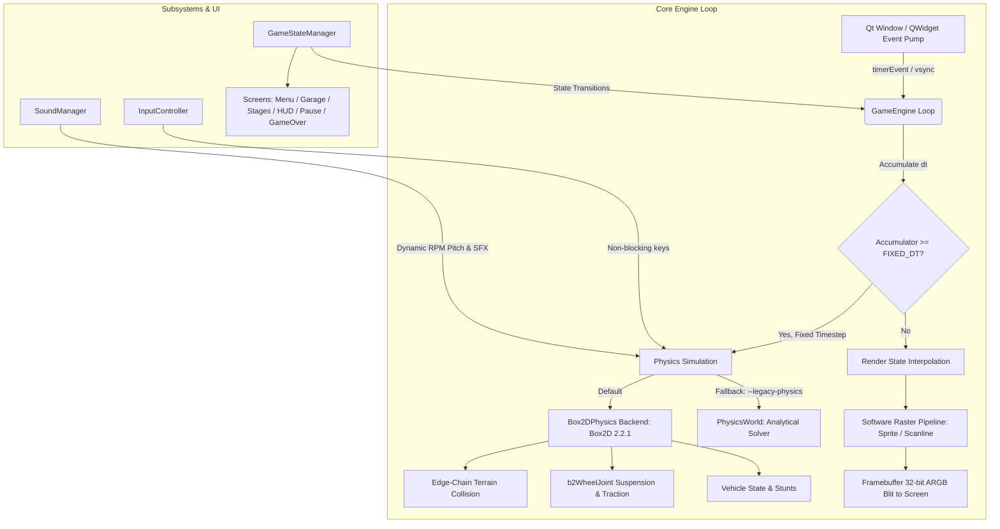

# Hill Climb Racing (Qt C++ Raster Edition) 🏎️⛰️
> **A High-Performance, Pixel-Perfect 2D Physics Racing Game Built with Qt 6 & Modern C++20**

---

## 🏆 Project Vision & Benchmark Goals
This project is engineered as an **exemplary academic and software engineering submission** that demonstrates mastery over:
1. **Deterministic Classical Mechanics & Vehicle Dynamics**: Multi-body rigid chassis, dual-wheel trailing arm / spring-damper suspension, Coulomb surface friction, in-air conservation of angular momentum, and Continuous Collision Detection (CCD). Default physics simulation is powered by a **vendored Box2D 2.2.1 engine** with an analytical `--legacy-physics` fallback mode.
2. **Pure Rasterization & Pixel Graphics**: Dedicated CPU software rasterizer writing directly to a 32-bit ARGB virtual framebuffer (`Framebuffer` class with `uint32_t*` scanline memory) — **strictly zero QPainter shapes, SVG, or vector hardware acceleration**.
3. **Enterprise-Grade Game Architecture**: Decoupled MVC / Component-Entity architecture, fixed-timestep accumulator game loop ($dt = 1/60\text{ s}$ / $1/120\text{ s}$ physics, $60\text{ Hz}$ render interpolation), state machine hierarchy, and robust memory management with zero memory leaks.
4. **Juicy & Addictive Gameplay Feel**: Dynamic camera tracking with velocity zoom, suspension squash & stretch, neck-snap kill condition, fuel timer tension, stunt evaluation (backflips, airtime, wheelies), 12 tuned vehicles, 6 biomes, and progressive garage vehicle upgrades across 8 categories (Engine, Suspension, Tires, 4WD, Brakes, Gearbox, Chassis, Aerodynamics).

---

## 🛠️ Technology Stack & Standards
- **Language**: Modern C++ (C++20 standard)
- **Framework**: Qt 6.11.1 on macOS (Core, Gui, Widgets, Multimedia)
- **Build System**: CMake 3.20+ with Ninja generator
- **Physics Backend**:
  - **Default**: Vendored Box2D 2.2.1 (`third_party/Box2D/`) with edge-chain colliders, dynamic bodies, and `b2WheelJoint` suspension constraints.
  - **Fallback**: Custom analytical impulse/spring-damper solver accessible via `--legacy-physics`.
- **Rendering Engine**: 100% pure software rasterizer writing to raw 32-bit ARGB buffers (`QImage` 0xAARRGGBB blitted to screen). No QPainter paths, SVGs, or vector primitives.
- **Audio Engine**: Low-latency dynamic audio synthesizer and mixer (`SoundManager`) with real-time engine RPM pitch shifting, tire skid effects, and environmental audio.
- **Testing**: Deterministic built-in custom CLI test suites with automated headless verification (note: custom CLI suites are used, not QTest).

---

## ⚡ Architecture Summary



- **`GameStateManager`**: Finite state machine orchestrating screen lifecycle:
  - `MainMenuScreen`: Title menu with animated multi-layer parallax hills and vehicle showcase.
  - `GarageScreen`: Interactive vehicle selector and 8-category tuning shop across 2 tabs (Engine, Suspension, Tires, 4WD, Brakes, Gearbox, Chassis, Aerodynamics) with dynamic hydraulic lift.
  - `StageSelectScreen`: Stage card browser supporting all 6 biomes with unlock requirements and distance records.
  - `HUD`: In-game dashboard with analog needle speedometer, tachometer, segmented LED fuel alarm, minimap radar, and telemetry card.
  - `PauseOverlay`: Responsive modal dialog with resume, restart, garage, and main menu actions.
  - `GameOverScreen`: Detailed run breakdown (distance traveled, coins collected, flips, airtime, and record status).
- **`PhysicsWorld` & `Vehicle` Facade**: Unified abstraction layer bridging simulation state to renderers regardless of whether Box2D or legacy physics is active.
- **`Box2DPhysics`**: Production-grade physics implementation utilizing vendored Box2D 2.2.1 with edge-chain terrain colliders, wheel joints, and fixed 60 Hz substep accumulator.
- **Software Graphics Pipeline**: Direct CPU memory manipulation (`Framebuffer`, `ScanlineRasterizer`, `Sprite` rotation blitter, and `ParticleSystem`).

---

## 🚀 Building & Running

### macOS Build (Recommended)
Make sure Qt 6.11.1 (or compatible Qt 6.x), CMake, and Ninja are installed:

```bash
# Configure with Ninja and Qt 6
cmake -B build -G Ninja -DCMAKE_PREFIX_PATH="/Users/anubhabrakshit/Qt/6.11.1/macos"

# Build Hill Climb Racing executable
cmake --build build -j8
```

*Note*: If CMake is located in your Qt Tools directory, you can invoke it directly:
```bash
/Users/anubhabrakshit/Qt/Tools/CMake/CMake.app/Contents/bin/cmake --build build -j8
```

### Windows & Linux Setup Notes
- **Windows**: Install Qt 6.x (Desktop C++ MinGW or MSVC 2022) via the Qt Online Installer. From the Qt Command Prompt or VS Developer Prompt, run `cmake -B build -G "Ninja" -DCMAKE_PREFIX_PATH="C:/Qt/6.x.x/mingw_64"` followed by `cmake --build build`.
- **Linux**: Install Qt 6 development packages (`qt6-base-dev`, `qt6-multimedia-dev`, `cmake`, `ninja-build`). Run `cmake -B build -G Ninja` and `cmake --build build`.
- **Vendored Dependencies**: Box2D 2.2.1 is vendored under `third_party/Box2D/`, so no external Box2D installation is required across any operating system.

---

## 🎮 Run Commands

Launch with default Box2D 2.2.1 physics engine:
```bash
./build/HillClimbRacingQt
```

Launch with legacy analytical physics engine:
```bash
./build/HillClimbRacingQt --legacy-physics
```

---

## ⌨️ Controls

| Control Action | Player 1 (Single Player / Split-Screen Left) | Player 2 (Local Multiplayer Split-Screen Right) | System / Global |
| :--- | :--- | :--- | :--- |
| **Throttle / Accelerate** | `W` | `Up Arrow` | — |
| **Brake / Reverse** | `S` | `Down Arrow` | — |
| **Tilt Back (Air Pitch Up)** | `A` | `Left Arrow` | — |
| **Tilt Forward (Air Pitch Down)** | `D` | `Right Arrow` | — |
| **Pause / Resume** | — | — | `Esc` or `P` |
| **Quick Restart** | — | — | `R` |
| **Select / Confirm / Click** | — | — | `Enter` or `Space` |
| **Toggle Multiplayer Mode** | — | — | `M` (on Menu screen) |

---

## 🧪 Automated Testing & Verification

The project includes **7 comprehensive, deterministic CLI test suites**. Note that tests use custom built-in test runners (not Qt's QTest framework) and support headless offscreen execution via `QT_QPA_PLATFORM=offscreen`.

| Test Command | Scope & Invariants Verified |
| :--- | :--- |
| `QT_QPA_PLATFORM=offscreen ./build/HillClimbRacingQt --test-ui-layout` | Automated UI layout regression mode: validates screen bounds containment, button non-overlap, real HUD telemetry vs minimap radar clearance, modal panel containment, and exports 12 reference captures (6 screens x 2 resolutions) to `scratch/ui_regression/`. |
| `QT_QPA_PLATFORM=offscreen ./build/HillClimbRacingQt --test-box2d` | Verifies Box2D 2.2.1 integration: edge-chain collider, fixed-step 60Hz accumulator, substep clamp, deterministic simulation, idle stability, 12° slope brake hold, reverse drive, and in-air pitch torque. |
| `QT_QPA_PLATFORM=offscreen ./build/HillClimbRacingQt --test-box2d-vehicles` | Evaluates all 12 vehicles for idle stability, forward acceleration, reverse speed, dynamic braking, 15° slope climb, and mid-air attitude tilt. |
| `QT_QPA_PLATFORM=offscreen ./build/HillClimbRacingQt --test-box2d-world` | Full world integration: single-player drive, fuel drainage, suspension deformation, checkpoint crossings, split-screen multiplayer dual-vehicle physics, and neck-snap crash detection. |
| `QT_QPA_PLATFORM=offscreen ./build/HillClimbRacingQt --test-physics` | Comprehensive 19-test physics audit: drop landings, rebound oscillations, 60 km/h ground contact retention, ski jump trajectories, extreme tumble non-penetration (< 0.005m), speedometer accuracy, brake upgrades, and surface friction scaling (ice vs snow vs turf vs rock). |
| `QT_QPA_PLATFORM=offscreen ./build/HillClimbRacingQt --test-audio` | Validates volume hierarchy, BGM state crossfading, dynamic RPM pitch modulation, wheel rolling SFX, impact scaling, and multi-channel clipping limiter. |
| `QT_QPA_PLATFORM=offscreen ./build/HillClimbRacingQt --smoke-test` | End-to-end procedural terrain scan (fuel reachability across all biomes), stage progression unlocks, stationary idle check, checkpoint crossing, and visual screenshot generation. |

Run all tests together:
```bash
QT_QPA_PLATFORM=offscreen ./build/HillClimbRacingQt --test-ui-layout
QT_QPA_PLATFORM=offscreen ./build/HillClimbRacingQt --test-box2d
QT_QPA_PLATFORM=offscreen ./build/HillClimbRacingQt --test-box2d-vehicles
QT_QPA_PLATFORM=offscreen ./build/HillClimbRacingQt --test-box2d-world
QT_QPA_PLATFORM=offscreen ./build/HillClimbRacingQt --test-physics
QT_QPA_PLATFORM=offscreen ./build/HillClimbRacingQt --test-audio
QT_QPA_PLATFORM=offscreen ./build/HillClimbRacingQt --smoke-test
```

---

## 🌟 Current Features & Status

- **Physics Engine**: Box2D 2.2.1 is active and tuned by default; `--legacy-physics` fallback provides backward compatibility.
- **12 Playable Vehicles**:
  1. *Classic Off-Roader* (Balanced standard)
  2. *Rally Racing Car* (High agility & speed)
  3. *Modern Sports Coupe* (Low center-of-mass)
  4. *Venom Hyper-V12* (Extreme top speed)
  5. *Heavy-Duty Pickup* (High torque, stiff suspension)
  6. *Monster Truck* (Massive wheels, rough terrain master)
  7. *Desert Rally Raid* (Dune endurance)
  8. *Formula Racing Car* (High downforce)
  9. *Retro Muscle Car* (Rear-wheel power)
  10. *Electric Off-Roader* (Instant linear torque)
  11. *Motocross Bike* (Extreme air agility, high risk)
  12. *Quad Bike ATV* (Versatile 4-wheeler)
- **6 Procedural Stages / Biomes**:
  - *Countryside* (Rolling green pastures)
  - *Desert Dunes* (Shifting sand hills)
  - *Arctic Tundra* (Low-friction ice & snow)
  - *Mountain Ridge* (Steep rocky inclines)
  - *The Moon* (Low gravity, extended airtime)
  - *Inferno Peaks* (Extreme gradients and lava pits)
- **Multiplayer Mode**: Two-player local split-screen with independent cameras, vehicle choices, and race rankings.
- **Garage & Upgrade Economy**: Collect coins to level up 8 mechanical categories (Engine, Suspension, Tires, 4WD, Brakes, Gearbox, Chassis, Aerodynamics).
- **Audio & SFX**: Synthesized engine revving, tire skids, coin pickups, and CC0 background music tracks.

---

## ⚠️ Known Limitations & Testing Caveats

1. **Headless Execution**: When running tests on CI servers or headless environments without an active display server, prepend `QT_QPA_PLATFORM=offscreen` to prevent Qt from attempting to connect to a display server.
2. **Dynamic Link Paths (macOS)**: Running test binaries outside of a bundled `.app` on macOS requires access to the Qt framework libraries (e.g. via `DYLD_FRAMEWORK_PATH` or standard environment paths configured during Qt installation).
3. **Software Rasterizer Performance**: Because rendering occurs purely on the CPU via direct pixel buffer manipulation, running in debug mode (`-O0`) can cause lower framerates. Always compile with optimizations (`-O2` or `-O3`) for smooth 60 FPS gameplay.
4. **Testing Harness**: Automated tests are implemented directly inside the application executable as CLI modes; `QTest` headers are not linked.

---

## 📚 Master Engineering Specifications Directory
To read the complete blueprints for each domain, explore the dedicated documentation modules in [`docs/`](./docs/):

| Document | Focus Area | Description |
| :--- | :--- | :--- |
| **[01. Vision & Executive Summary](./docs/01_EXECUTIVE_SUMMARY_AND_VISION.md)** | Strategy & Grading Rubric | Evaluation breakdown, core differentiators, competitive edge, and player experience goals. |
| **[02. Physics Engine Specification](./docs/02_CORE_PHYSICS_ENGINE_SPECIFICATION.md)** | Math & Vehicle Dynamics | Full mathematical formulation of springs, dampers, torque, slip friction, collision impulses, and semi-implicit Euler integration. |
| **[03. Rasterization Pipeline](./docs/03_RASTERIZATION_AND_RENDER_PIPELINE.md)** | Graphics & Pixel Engine | Software framebuffer management, scanline terrain filling, sprite rotation algorithms, raster particles, and parallax. |
| **[04. Software Architecture & OOP](./docs/04_SOFTWARE_ARCHITECTURE_AND_CLASS_DESIGN.md)** | C++ Design Patterns | UML class diagrams, State pattern, fixed-timestep game loop, input buffering, and Qt event integration. |
| **[05. Gameplay Mechanics & Levels](./docs/05_GAMEPLAY_SYSTEMS_AND_LEVEL_GENERATION.md)** | Game Design & Procedural Math | Perlin/sinusoidal terrain generation, fuel drain balance, coin distribution, upgrade curves, and stunt detectors. |
| **[06. Team Roadmap & QA Protocols](./docs/06_TEAM_DIVISION_ROADMAP_AND_TESTING.md)** | Project Management & Testing | 4-week sprint plan, individual role assignments, CLI automated testing suite, and grading defense checklist. |
| **[07. GitHub Benchmark & Innovation](./docs/07_GITHUB_BENCHMARK_AND_INNOVATION.md)** | Open-Source Comparative Analysis | Audit of existing Box2D implementations, b2WheelJoint soft constraints, continuous circle-segment collision, and raster optimizations. |
| **[08. Brick-by-Brick Execution Plan](./docs/08_BRICK_BY_BRICK_EXECUTION_PLAN.md)** | Step-by-Step Construction Guide | The sequential 8-brick incremental construction roadmap with interfaces, math formulas, and acceptance criteria. |
| **[Teammate Onboarding & Physics Guide](./docs/DEVELOPER_SETUP_AND_FRIENDS_GUIDE.md)** | Developer Guide for Friends | Step-by-step instructions for teammates to build with CMake and tune the physics/math engine. |
