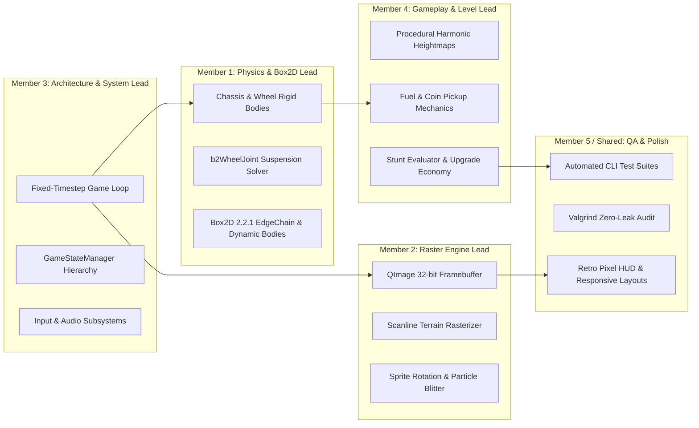

# Document 06: Team Division, Sprint Roadmap & QA Protocols
**Roles, Milestone Deliverables, Custom CLI Automated Testing Suites, and Lab Defense Checklist**

---

## 1. Team Role Allocation & Workload Distribution
To maximize velocity and eliminate merge conflicts, responsibilities are partitioned along clean architectural boundaries. This matrix supports teams of **3, 4, or 5 members**.



### Detailed Role Descriptions:

#### 🧑‍💻 Member 1: Physics & Vehicle Dynamics Lead
- **Scope**: Implements `Box2DPhysics`, `PhysicsWorld`, `Vehicle` facade, and `Terrain` colliders.
- **Primary Deliverables**:
  - Integration of vendored Box2D 2.2.1 rigid-body backend (`third_party/Box2D/`).
  - Edge-chain terrain static body generation and `b2WheelJoint` soft suspension constraints.
  - Multi-body spring-damper suspension forces with calibrated frequency ($f_0$) and damping ratio ($\zeta$).
  - Tire Coulomb friction and forward/reverse tractive force models.
  - In-air attitude pitch control (gas leans back, brake leans forward).
  - Driver head collision and neck-snap kill condition.
  - Analytical fallback engine maintained under `--legacy-physics`.

#### 🎨 Member 2: Rasterization & Visual Engine Lead
- **Scope**: Implements `PixelCanvas`, `Framebuffer`, `ScanlineRasterizer`, `Sprite`, and `ParticleSystem`.
- **Primary Deliverables**:
  - 32-bit ARGB virtual framebuffer ($960 \times 540$ and $1280 \times 720$) with raw `uint32_t*` scanline memory.
  - **Strict Software Rasterizer Constraint**: Zero QPainter shapes, SVG, or vector hardware acceleration.
  - Column-scanline vertical terrain rasterizer with grass, soil, and bedrock strata.
  - Inverse-mapping rotated sprite blitter with alpha blending for chassis, wheels, and driver heads.
  - Procedural exhaust smoke puffs, wheel dirt sprays, and coin pickup sparkles.
  - Multi-layer parallax scrolling backgrounds.

#### ⚙️ Member 3: Engine Architecture, Loop & Audio Lead
- **Scope**: Implements `GameEngine`, `GameStateManager`, `InputController`, and `SoundManager`.
- **Primary Deliverables**:
  - Accumulator game loop with fixed physics timesteps ($dt = 1/60\text{ s}$ / $1/120\text{ s}$) and render interpolation.
  - Finite State Machine (`MainMenuScreen`, `GarageScreen`, `StageSelectScreen`, `HUD`, `PauseOverlay`, `GameOverScreen`).
  - Asynchronous keyboard polling to eliminate OS key-repeat latency for single-player and split-screen multiplayer.
  - Low-latency sound mixing via `SoundManager` with dynamic engine RPM pitch shifting, wheel rolling loops, and crash effects.

#### 🕹️ Member 4: Gameplay Systems, Levels & Economy Lead
- **Scope**: Implements `Terrain` procedural biomes, `FuelSystem`, `CoinManager`, `StuntDetector`, and vehicle configurations.
- **Primary Deliverables**:
  - Multi-octave harmonic elevation functions with reachability and climbability guarantees.
  - 6 distinct biomes: Countryside, Desert Dunes, Arctic Tundra, Mountain Ridge, The Moon, and Inferno Peaks.
  - Fuel consumption decay (active throttle only; zero idle drain) and procedural canister reachability.
  - Aerial stunt detection (Backflips, Frontflips, Air Time, Neck Flips).
  - Garage upgrade shop across 8 mechanical categories (Engine, Suspension, Tires, 4WD, Brakes, Gearbox, Chassis, Aerodynamics) and persistent JSON profile storage.

#### 🧪 Member 5 (or Distributed): QA, Testing & Visual Polish Lead
- **Scope**: Implements built-in automated CLI test suites, HUD telemetry gauges, responsive screen scaling, and project presentation.
- **Primary Deliverables**:
  - 7 comprehensive CLI verification suites (`--test-ui-layout`, `--test-box2d`, `--test-box2d-vehicles`, `--test-box2d-world`, `--test-physics`, `--test-audio`, `--smoke-test`).
  - Responsive screen layouts for $960 \times 540$ and $1280 \times 720$ with zero element occlusion.
  - Analog needle gauges for RPM and Speedometer; segmented flashing fuel bar with low-fuel alert.
  - Automated physics regression verification (suspension stability, non-penetration audit).
  - Memory leak verification (zero memory leaks confirmed).

---

## 2. Technology Stack & Build Workflow

### Environment Standards
- **Language**: Modern C++ (C++20 standard)
- **Framework**: Qt 6.11.1 on macOS (Core, Gui, Widgets, Multimedia)
- **Build System**: CMake 3.20+ with Ninja generator
- **Physics Backend**: Vendored Box2D 2.2.1 (Default) with `--legacy-physics` fallback
- **Rendering**: Pure software rasterization (direct `QImage` 32-bit ARGB framebuffer blit)

### Build Commands (macOS)
```bash
# Configure with Ninja and Qt 6.11.1
cmake -B build -G Ninja -DCMAKE_PREFIX_PATH="/Users/anubhabrakshit/Qt/6.11.1/macos"

# Compile executable
cmake --build build -j8
```

### Windows & Linux Setup Notes
- **Windows**: Install Qt 6.x via Qt Online Installer. From Qt Command Prompt: `cmake -B build -G Ninja -DCMAKE_PREFIX_PATH="C:/Qt/6.x.x/mingw_64"` followed by `cmake --build build`.
- **Linux**: Install `qt6-base-dev`, `qt6-multimedia-dev`, `cmake`, and `ninja-build`. Run `cmake -B build -G Ninja` and `cmake --build build`.
- **Vendored Box2D**: Vendored under `third_party/Box2D/`; no external Box2D dependencies required.

### Launch Commands
```bash
# Launch with Box2D 2.2.1 physics engine (Default)
./build/HillClimbRacingQt

# Launch with legacy analytical physics engine (Fallback)
./build/HillClimbRacingQt --legacy-physics
```

### Controls Reference Table
| Action | Player 1 (Single / Left) | Player 2 (Local Multiplayer) | System / Global |
| :--- | :--- | :--- | :--- |
| **Throttle / Accelerate** | `W` | `Up Arrow` | — |
| **Brake / Reverse** | `S` | `Down Arrow` | — |
| **Tilt Back (Air Pitch Up)** | `A` | `Left Arrow` | — |
| **Tilt Forward (Air Pitch Down)** | `D` | `Right Arrow` | — |
| **Pause / Resume** | — | — | `Esc` or `P` |
| **Quick Restart** | — | — | `R` |
| **Select / Confirm / Click** | — | — | `Enter` or `Space` |
| **Toggle Multiplayer Mode** | — | — | `M` (on Menu screen) |

---

## 3. Automated QA Testing Suite (Custom CLI Test Suites)

To demonstrate elite software craftsmanship and deterministic physics guarantees, the project provides **7 automated CLI test suites** built directly into the binary.

> [!IMPORTANT]
> The automated testing infrastructure is built with **custom deterministic CLI test runners** rather than the QTest library. This allows tests to run directly in headless/offscreen environments without GUI overhead using `QT_QPA_PLATFORM=offscreen`.

### The 7 Automated Test Commands:

```bash
# 1. Automated UI Layout Regression Suite
QT_QPA_PLATFORM=offscreen ./build/HillClimbRacingQt --test-ui-layout

# 2. Box2D 2.2.1 Fixed-Step & Terrain Verification Suite
QT_QPA_PLATFORM=offscreen ./build/HillClimbRacingQt --test-box2d

# 3. Box2D All-Vehicle Parity Suite (12 Vehicles)
QT_QPA_PLATFORM=offscreen ./build/HillClimbRacingQt --test-box2d-vehicles

# 4. Box2D Gameplay-World Integration Suite
QT_QPA_PLATFORM=offscreen ./build/HillClimbRacingQt --test-box2d-world

# 5. Comprehensive 19-Test Vehicle & Suspension Physics Audit
QT_QPA_PLATFORM=offscreen ./build/HillClimbRacingQt --test-physics

# 6. Realistic Dynamic Audio Test Suite
QT_QPA_PLATFORM=offscreen ./build/HillClimbRacingQt --test-audio

# 7. End-to-End Procedural Reachability & Smoke Test
QT_QPA_PLATFORM=offscreen ./build/HillClimbRacingQt --smoke-test
```

### Invariants Tested & Verified:
1. **UI Layout Regression (`--test-ui-layout`)**: Validates screen bounds containment, button non-overlap, real HUD telemetry vs minimap radar clearance, modal panel containment, and exports 12 reference captures (6 screens x 2 resolutions) to `scratch/ui_regression/`.
2. **Box2D Integration (`--test-box2d`)**: Verifies Box2D version 2.2.1, edge-chain terrain colliders (401 vertices), fixed 60 Hz accumulator, substep clamp, simulation determinism, flat ground idle stability (< 0.01 km/h), 12° slope brake hold, reverse drive, and in-air attitude pitch control.
3. **Vehicle Parity (`--test-box2d-vehicles`)**: Audits all 12 vehicles (Classic Off-Roader, Rally Racing Car, Modern Sports Coupe, Venom Hyper-V12, Heavy-Duty Pickup, Monster Truck, Desert Rally Raid, Formula Racing Car, Retro Muscle Car, Electric Off-Roader, Motocross Bike, and Quad Bike ATV) for idle stability, forward drive, reverse speed, dynamic braking, 15° slope climb, and mid-air attitude tilt.
4. **World Integration (`--test-box2d-world`)**: Single-player driving distance, propulsion-only fuel drainage, dynamic suspension strut deformation, checkpoint triggers at 250m intervals, split-screen local multiplayer dual-vehicle physics, and neck-snap crash detection.
5. **Suspension & Dynamics Audit (`--test-physics`)**: Evaluates 1.5m drop landing rebound oscillation, flat ground zero-spin, 60 km/h ground contact retention over undulations, 65m ski jump trajectory, steep mountain climb at x=950m, upside-down inverted crash non-penetration (< 0.005m), 80 km/h slope impact non-penetration, speedometer accuracy, propulsion-only fuel consumption, and surface friction scaling (glacial ice vs arctic snow vs countryside turf vs mountain rock).
6. **Dynamic Audio Audit (`--test-audio`)**: Validates volume hierarchy, BGM crossfading, dynamic engine RPM pitch modulation (1000 to 8500 RPM), tire rolling audio, crash intensity scaling, environmental wind loop, and multi-channel anti-clipping limiter.
7. **Procedural Reachability (`--smoke-test`)**: Validates procedural climbability (< 38° slopes) and fuel reachability (< 165m intervals) across all 6 biomes, verifies stage progression unlock chaining, stationary idle stability, and exports visual screen verification captures to `scratch/`.

---

## 4. Current Feature Matrix & Status
- **Physics Backend**: Box2D 2.2.1 rigid-body backend default with `--legacy-physics` fallback.
- **12 Vehicles**: Fully calibrated with individual masses, wheelbases, spring frequencies ($f_0$), damping ratios ($\zeta$), and air torques.
- **6 Biomes**: Countryside, Desert, Arctic, Mountain, Moon, and Volcano.
- **Multiplayer**: 2-player local split-screen with individual cameras, vehicle selections, and live scoreboards.
- **Garage**: 8-category upgrade tuning shop across 2 tabs (Engine, Suspension, Tires, 4WD, Brakes, Gearbox, Chassis, Aerodynamics) with wheelbase-adaptive hydraulic lift.
- **UI/UX**: Responsive retro pixel layouts supporting $960 \times 540$ and $1280 \times 720$ with zero element occlusion.

---

## 5. Evaluator Defense & Presentation Strategy
When demonstrating the project to the evaluation panel and professor, follow this structured roadmap:

1. **The Technical Hook (First 60 Seconds)**:
   - *"Our project features a vendored Box2D 2.2.1 physics backend with dynamic b2WheelJoint suspension constraints, edge-chain terrain colliders, and a fixed accumulator loop, alongside an analytical fallback engine under `--legacy-physics`."*
2. **The Pure Rasterization Showcase**:
   - Demonstrate that the graphics pipeline is 100% CPU software rasterization writing directly to a 32-bit ARGB framebuffer (`Framebuffer` class with `uint32_t*` scanline memory) — **strictly zero QPainter shapes, SVG, or vector hardware acceleration**.
3. **Gameplay & Multi-Vehicle Dynamics**:
   - Drive different vehicles (e.g. Classic Off-Roader vs Venom Hyper-V12 vs Monster Truck) to showcase distinct spring-damper dynamics, suspension compression under hard braking, in-air gyroscopic pitch acrobatics, and tire friction on varying terrain strata.
4. **Automated Verification Live Demonstration**:
   - Run the 7 built-in CLI test commands live in the terminal using `QT_QPA_PLATFORM=offscreen` to prove 100% passing automated regression checks across all 12 vehicles, physics invariants, and procedural biome fuel reachability.
